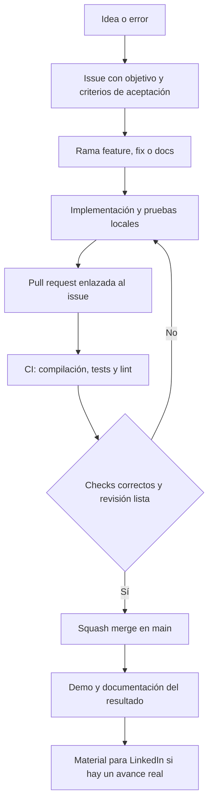

# Play Box

Proyecto personal de juegos para mostrar diseño, programación y aprendizaje mediante experiencias pequeñas y terminadas.

**Estado actual:** base Android con Jetpack Compose, MVVM por funcionalidades, casos de uso, repositorios, Koin y Room 3 y un juego de memoria de cuatro parejas con récord persistente. **macOS es un objetivo futuro**, todavía sin implementación. El proyecto aún no es una aplicación de juegos terminada.

## Desarrollo

Abrir el proyecto en Android Studio y configurar el SDK local. El proyecto usa el Gradle Wrapper 9.6.0, Android Gradle Plugin 9.4.1, SDK 37 y un daemon Java 25 definido en `gradle/gradle-daemon-jvm.properties`. El código tiene compatibilidad Java 11; esto no es la versión de Java que ejecuta Gradle.

```sh
./gradlew :app:assembleDebug :app:testDebugUnitTest :app:lintDebug
```

Los tests unitarios comprueban reglas del juego y el caso de uso de récords. La prueba instrumentada de la base de datos requiere dispositivo o emulador.

[Arquitectura y diagrama de capas](docs/ARCHITECTURE.md) · [Versiones y mantenimiento](docs/VERSIONS.md)

## Flujo de trabajo



- [Guía para contribuir](.github/CONTRIBUTING.md)
- [Flujo y comprobaciones](docs/WORKFLOW.md)
- [Hoja de ruta](docs/ROADMAP.md)
- [Qué subir y qué excluir](docs/REPOSITORY_HYGIENE.md)

## Plataformas

| Plataforma | Estado |
| --- | --- |
| Android | Compose + MVVM + Memoria y récord local |
| macOS | Planificado; arquitectura por decidir |

La CI actual valida Android en Linux. No genera una app para macOS ni publica en tiendas.
