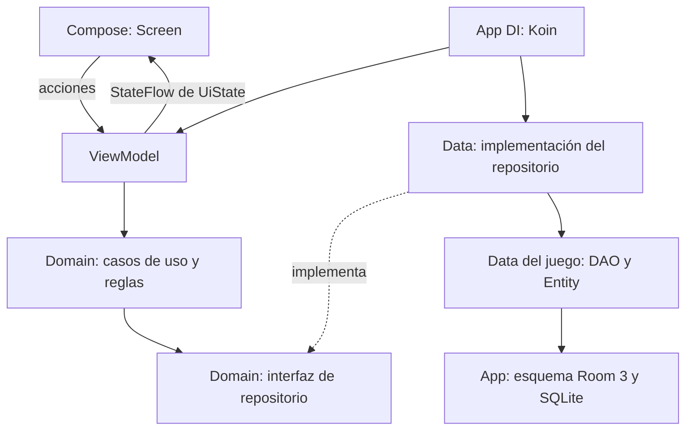

# Arquitectura de Play Box

MVVM con flujo unidireccional y organización por funcionalidad dentro del módulo `app`.



## Carpetas

```text
app/                           # Composición, navegación, esquema global y DI
core/
  data/database/               # Factory genérica Room + SQLite
  domain/model/                # Metadatos compartidos del catálogo
  presentation/theme/          # Tema Compose compartido
feature/
  home/
    data/                      # Implementación local de GameRepository
    domain/repository/         # Contrato GameRepository
    presentation/              # HomeViewModel, UiState y HomeScreen
  memory/
    data/local/                # Entity y DAO propios de Memoria
    data/repository/           # Implementación Room
    domain/model/              # Reglas puras del juego
    domain/repository/         # Contrato de persistencia
    domain/usecase/            # Inicio, cartas, observación y guardado
    presentation/              # ViewModel, UiState y pantalla Compose
```

`domain` no importa Android, Compose, Room ni implementaciones de `data`. La UI recoge el estado con ciclo de vida y envía acciones al ViewModel. El ViewModel sobrevive a cambios de configuración; la partida activa no se restaura tras muerte del proceso. Los récords sí persisten en SQLite. No se añaden clases base MVVM genéricas sin una necesidad real.

Koin arranca una sola vez en `PlayBoxApplication`. Sus módulos se registran desde `appModules`: `databaseModule`, `homeModule` y `memoryModule`. La base y los repositorios son `single`; los casos de uso son `factory`; los ViewModels se registran con `viewModel` y Compose los obtiene con `koinViewModel()`. La aplicación crea una base de datos para su vida completa. Las entidades y consultas pertenecen a cada juego; `app/data/database` reúne el esquema y `app/di` registra la base y reúne los módulos Koin de los juegos. `core` no importa ninguna funcionalidad. El guardado del récord usa un UPSERT con MIN para no perder el mejor resultado con escrituras concurrentes. No se habilita migración destructiva. Los esquemas JSON se versionan en `app/schemas/`; cambios futuros requieren subir versión y definir migración.

## Tecnología elegida

- Jetpack Compose y Material 3 para la interfaz.
- ViewModel, StateFlow y coroutines para estado y trabajo asíncrono.
- Room 3.0.3 estable, KSP y SQLite Bundled para persistencia local tipada con consultas comprobadas al compilar.
- Koin 4.2.2 con DSL explícita e inyección por constructor: dependencias registradas en módulos y repositorios sustituibles en tests. `domain` no usa Koin ni service locator.

[Room 3](https://developer.android.com/jetpack/androidx/releases/room3) tiene soporte multiplataforma. [SQLite Bundled](https://developer.android.com/kotlin/multiplatform/room) permite consistencia entre plataformas. Esta elección facilita una futura extracción a Kotlin Multiplatform, **pero este código sigue siendo Android**: no existe aún un target macOS, source sets compartidos ni una app de escritorio.

## Añadir un juego

1. Crear `feature/nombre/{data,domain,presentation}`; empezar por reglas y tests en `domain`.
2. Añadir entidades y DAO solo si necesita persistencia; registrarlos en la base compartida y planificar migración.
3. Implementar el repositorio definido en `domain`, crear los casos de uso y registrarlos en el módulo Koin de la funcionalidad. Añadir ese módulo a `appModules`.
4. Exponer `UiState` inmutable y acciones en ViewModel; dibujar estado en Compose.
5. Registrar metadatos en el catálogo y destino en `PlayBoxApp`.

Se usan paquetes, no módulos Gradle por capa. Cuando crezca el proyecto, se podrán extraer módulos para que las fronteras de dependencias sean también verificadas por Gradle.

## Casos de uso y repositorios

| Funcionalidad | Casos de uso | Contrato de repositorio |
| --- | --- | --- |
| Inicio | `GetGames` | `GameRepository` |
| Memoria | `StartMemoryGame`, `RevealMemoryCard`, `ConcealMemoryCards`, `ObserveMemoryRecord`, `SaveMemoryRecord` | `MemoryRecordRepository` |

Los ViewModels no crean casos de uso ni conocen los repositorios. El modelo `MemoryGame` contiene las reglas; los casos de uso exponen las operaciones de la aplicación. Reiniciar reutiliza `StartMemoryGame`. `SaveMemoryRecord` rechaza partidas sin finalizar y resultados imposibles antes de persistir. `ObserveMemoryRecord` entrega un Flow reactivo.

El test `AppModulesTest` resuelve los módulos de producción con un DAO de prueba: comprueba catálogo y ViewModels, y el recorrido caso de uso → repositorio Room → DAO → Flow → ViewModel. No sustituye la prueba instrumentada de SQLite, que sigue necesitando un dispositivo.

Referencia: [Koin para Compose](https://insert-koin.io/docs/reference/koin-compose/compose-viewmodel/).
